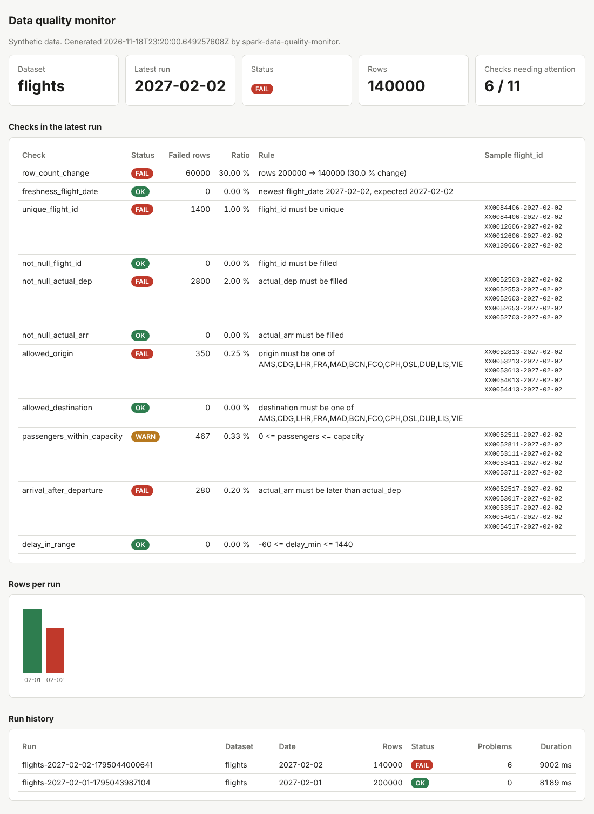

# Spark Data Quality Monitor

Scala and Apache Spark job that checks a daily batch of flight operations data before it is
used, alerts on Microsoft Teams or by email when something is wrong, keeps a run history for a
monitoring dashboard, and measures how much Parquet and Spark settings change pipeline speed.

**AI-assisted personal project, November 2026.** All data is synthetic: carrier `XX`, flight
numbers and values are made up. It is not connected to any airline system.



## What it does

| Part | Where | Status |
|---|---|---|
| Synthetic daily batches, with known defects injected on demand | `Generator.scala` | run locally |
| 11 data quality checks with WARN / FAIL thresholds | `Checks.scala` | run locally |
| Run result JSON, run history, exit code 0 / 1 / 2 for a scheduler | `Main.scala`, `Outputs.scala` | run locally |
| Monitoring dashboard (status per check, sample failing ids, rows per run, history) | `Outputs.scala` | run locally |
| Teams Adaptive Card and email (.eml) on WARN / FAIL | `Notify.scala`, `scripts/send_email.py` | built and validated; posted only if a webhook / SMTP server is configured |
| CSV vs Parquet benchmark, shuffle partitions, AQE, memory of cached data, physical plans | `Benchmark.scala` | run locally |
| Bigtable row-key design and `cbt import` file per run | `Outputs.scala`, `gcp/bigtable/` | file generated; not imported into a real instance |
| BigQuery load and the same checks in SQL | `gcp/bigquery/` | script written; not run against a GCP project |
| Dataproc Serverless submit script | `gcp/dataproc/` | script written; not run against a GCP project |

## Checks

| Check | Rule | WARN above | FAIL above |
|---|---|---:|---:|
| `row_count_change` | change against the previous run of the dataset | 10 % | 25 % |
| `freshness_flight_date` | newest `flight_date` equals the run date | | any |
| `unique_flight_id` | no duplicated key | | any |
| `not_null_flight_id` | key is filled | | any |
| `not_null_actual_dep`, `not_null_actual_arr` | times are filled | 0.2 % | 1 % |
| `allowed_origin`, `allowed_destination` | known airport code | | 0.1 % |
| `passengers_within_capacity` | 0 <= passengers <= capacity | 0.1 % | 1 % |
| `arrival_after_departure` | `actual_arr` later than `actual_dep` | | 0.1 % |
| `delay_in_range` | -60 <= `delay_min` <= 1440 | | 0.1 % |

Each failing check keeps up to five sample `flight_id` values so the problem rows can be found.

## Recorded run (evidence/)

`scripts/run_demo.sh` on 19 November 2026, Spark 4.0.1, Scala 2.13.16, Java 21, one machine, `local[2]`:

- **Tests:** 16 passed, 0 failed (`evidence/tests.txt`).
- **Day 1**, 200,000 clean rows: all 11 checks OK, no notification, exit code 0.
- **Day 2**, 140,000 rows with injected defects: FAIL, exit code 2. Six checks caught the problems:
  row count -30 %, 1,400 rows with duplicated ids, 2,800 missing departure times, 350 unknown
  airport codes, 280 arrivals before departure (FAIL) and 467 rows above capacity (WARN).
  Teams payload and email written in dry-run mode.

Benchmark on 2,000,000 rows (`evidence/benchmark.md`, median of 3 runs):

| | CSV | Parquet (snappy) |
|---|---:|---:|
| Size on disk | 268.8 MB | 23.9 MB |
| Group by origin, all rows | 1,472 ms | 356 ms |
| Load factor, 2 of 10 columns | 1,169 ms | 228 ms |
| Filter AMS and delay > 60 min | 1,018 ms | 266 ms |

| Group by origin and destination (Parquet) | Median |
|---|---:|
| AQE off, 200 shuffle partitions | 1,220 ms |
| AQE off, 8 shuffle partitions | 353 ms |
| AQE on, 200 shuffle partitions | 472 ms |

| Spark cache of the Parquet data | Memory |
|---|---:|
| All 10 columns | 77.3 MB |
| Only origin, delay_min, passengers | 8.6 MB |

What this shows: Parquet is about 11x smaller here and about 4-5x faster to query, mostly because
Spark reads only the needed columns (`ReadSchema` in `evidence/plans.txt`) and pushes filters
into the scan (`PushedFilters`). With little data per key, 200 shuffle partitions are mostly
overhead; adaptive query execution coalesces them and gets most of the gain of hand tuning.
Caching only the columns a report needs uses about 9x less memory than caching the whole table. These
are single-machine numbers; on a Dataproc cluster the absolute times and the best settings will
differ, so measure again there.

## Run it

Requirements: Java 17 or 21, Python 3, and a Spark 4 install with Scala 2.13. The simplest way
is the PyPI package, which ships the Spark jars and `spark-submit`:

```sh
pip install pyspark==4.0.1
bash scripts/build.sh        # compiles with the Scala compiler bundled in the Spark jars
bash scripts/run_demo.sh     # tests, two daily batches, dashboard, notifications, benchmark
```

`ROWS` and `BENCH_ROWS` change the batch and benchmark sizes. With sbt installed, `sbt package`
also works (`build.sbt`, Spark marked as provided).

Single commands:

```sh
SUBMIT="spark-submit --class dq.Main target/spark-data-quality-monitor.jar"
$SUBMIT generate --rows 100000 --date 2027-02-03 --defects --out out/data/flights_2027-02-03
$SUBMIT check --input out/data/flights_2027-02-03 --dataset flights --run-date 2027-02-03 --out out
$SUBMIT benchmark --rows 2000000 --out out/benchmark
$SUBMIT test
```

## Notifications

On WARN or FAIL the check job writes `out/notifications/teams_<run>.json` and
`email_<run>.eml`.

- **Teams:** set `TEAMS_WEBHOOK_URL` to a Teams Workflows webhook URL and the Adaptive Card is
  posted with Java's HTTP client. Without it, nothing leaves the machine.
- **Email:** `python3 scripts/send_email.py out/notifications/email_<run>.eml` shows what would be
  sent; add `--send` with `SMTP_HOST`, `SMTP_PORT`, `SMTP_USER`, `SMTP_PASSWORD` set. `MAIL_TO`
  and `MAIL_FROM` set the addresses when the job runs.

Neither was sent to a real channel or mailbox in the recorded run.

## Google Cloud

- `gcp/dataproc/submit_dataproc.sh` uploads the jar and a batch to GCS and submits the check job
  to Dataproc Serverless. Pick a runtime with Spark 4 and Scala 2.13.
- `gcp/bigquery/load_and_check.sh` loads a Parquet batch into BigQuery and runs `checks.sql`, the
  same rules written in BigQuery Standard SQL. The BigQuery sandbox is enough for this.
- `gcp/bigtable/README.md` describes the `dq_metrics` table: row key
  `<dataset>#<check>#<reverse timestamp>` so the newest result of a check is one prefix read away.

None of these were run against a GCP project; they need your project, region and bucket.

## Limits

- One machine and synthetic data. No real airline data, no production deployment.
- Thresholds are examples, not tuned on real data.
- The dashboard is a static HTML file regenerated after each run, not a live service.
- Dataproc, BigQuery and Bigtable parts are scripts and designs that were not executed.

## Résumé en français

Job Scala/Spark de contrôle qualité sur des données de vols fictives : 11 contrôles avec seuils
WARN/FAIL, historique des exécutions, tableau de bord HTML, alertes Teams (Adaptive Card) et
e-mail, comparaison CSV/Parquet, réglage des partitions de shuffle et d'AQE, mémoire du cache. Exécuté en local
(16 tests réussis). Les scripts Dataproc, BigQuery et Bigtable sont fournis mais n'ont pas été
exécutés sur un projet GCP.

MIT, Copyright 2026 Bibin Vellangott Cheruvadi.
